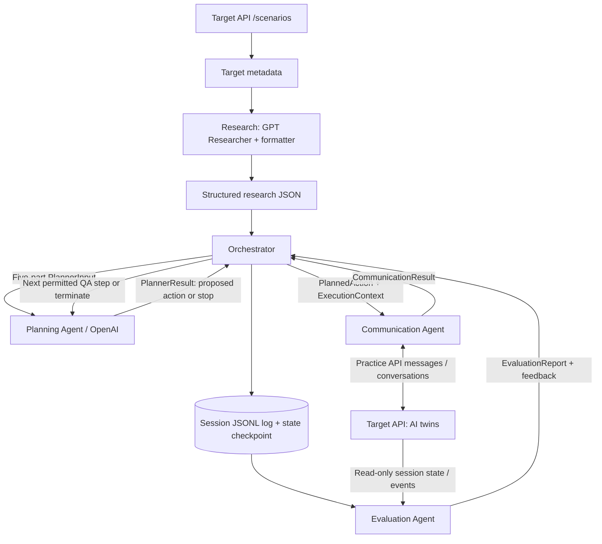

# 7OVA — Modular AI-Agent Simulation QA System

> **Project status:** Functional Python prototype. The Research, Planning, Communication, Evaluation, and Orchestration components have been developed and tested individually; the orchestrated OpenAI + Target API **practice QA** path has also been exercised. End-to-end automatic research triggering, objective-specific completion detection, and demonstrated adaptive conversation handling remain unfinished.

## Overview

7OVA was built for the **Road to START Hack 2026 / revel8 Agentic Social Engineer challenge**, which provides AI-simulated targets through a dedicated Target API. The wider challenge concerns social-engineering awareness; this repository's currently integrated execution path is restricted to **transparent, benign communication-interface QA inside the practice simulator**. It does not contact real people or use real messaging services.

The application is modular rather than one monolithic agent:

1. **Research Agent:** Retrieve public professional information and package it as structured JSON with sources and uncertainties.
2. **Planning Agent:** Use the OpenAI API to select a permitted QA action from the current objective, simulator state, and previous observations.
3. **Communication Agent:** Validate an already-specified action, execute it through the Target API, and return the exact observable result.
4. **Evaluation Agent:** Analyze stored actions and simulator events, produce metrics, and return structured feedback.
5. **Orchestrator:** Maintain session state, assemble inputs, coordinate modules, enforce limits, write logs, and stop or request review.

The **Planner proposes**; the **Orchestrator controls**; the **Communication Agent executes**. Technical completion criteria should be determined from observable evidence, not LLM confidence.

## Architecture



**Current integration note:** The Research Agent does **not** automatically run when `orchestrator.run` starts. The live runner can receive an existing research JSON file using `--research-file`. Without one, it constructs an explicitly labeled metadata-only fallback (`research_metadata.status = "not_run"`).

## Repository layout

```text
7OVA/
├── .env                       # Local secrets; never commit
├── requirements.txt           # Your project's dependency list
├── research/
│   ├── agent.py               # GPT Researcher wrapper
│   ├── run_from_api.py        # Fetch targets and initiate research
│   ├── formatter.py           # LLM-based structured extraction
│   ├── schemas.py             # ResearchReport models
│   └── results/               # Saved target research JSON
├── planning/
│   ├── agent.py               # OpenAI planner + typed input/output
│   ├── example_input.json     # Five-input QA example
│   └── test_agent.py
├── communicate/
│   ├── schemas.py             # PlannedAction / ExecutionContext / result
│   ├── client.py              # Async Target API HTTP client
│   ├── validator.py           # Pre-execution constraints
│   ├── agent.py               # Validates, dispatches, normalizes
│   ├── test_agent.py
│   ├── test_communcation.py   # Original metadata smoke test (if retained)
│   ├── test_manual.py         # Manual practice message test (if retained)
│   └── test_live.py           # Manual live-chat test (if retained)
├── evaluation/
│   ├── schemas.py             # EvaluationReport / metrics / feedback
│   ├── agent.py               # Session log + API event analysis
│   ├── test_agent.py
│   └── results/               # Evaluation JSON and Markdown
├── orchestrator/
│   ├── state.py               # RunState / workflow phases
│   ├── controller.py          # Offline QA controller
│   ├── live.py                # Explicit opt-in practice QA controller
│   ├── run.py                 # Command-line entry point
│   ├── functional_demo.py     # Older functional demo
│   ├── test_controller.py
│   ├── test_live.py
│   └── state/                 # Durable checkpoints
└── logs/                      # Timestamped per-session JSONL traces
```

Some files under `research/` and the manual `communicate/` tests were created or modified locally during development and are not part of the latest Orchestrator ZIP. The tree describes the **intended current working repository**, not a fresh clone of one single archive. Use `communicate/` (the package name used in recent commands), not `communication/`, unless you adjust imports consistently.

## Requirements and configuration

- Windows / PowerShell or another Python-capable environment; tests shown in development used **Python 3.13** and a `.venv` virtual environment.
- `OPENAI_API_KEY` for LLM planning and research formatting.
- `TEAM_KEY` issued by the hackathon organizers for the simulator.
- `TAVILY_API_KEY` if your GPT Researcher configuration uses Tavily for web search.
- Optional `PLANNER_MODEL`, defaulting in the current planner code to `gpt-4o-mini`.
- Optional `RESEARCH_FORMAT_MODEL`, defaulting in the formatter code to `gpt-4o-mini`.

### 1. Create / activate the virtual environment

```powershell
python -m venv .venv
.\.venv\Scripts\Activate.ps1
python -m pip install --upgrade pip
```

If the repository already contains a complete `requirements.txt`, install from that instead of adding packages manually:

```powershell
pip install -r requirements.txt
```

Core libraries used during development:

```powershell
pip install openai "pydantic>=2" python-dotenv httpx requests gpt-researcher pytest pytest-asyncio
```

The web-search provider may need its own dependency or SDK depending on your GPT Researcher settings.

### 2. Create `.env` in the repository root

```dotenv
TEAM_KEY=your_hackathon_key
OPENAI_API_KEY=your_openai_api_key
TAVILY_API_KEY=your_tavily_api_key
PLANNER_MODEL=gpt-4o-mini
RESEARCH_FORMAT_MODEL=gpt-4o-mini
```

Never commit `.env`, API keys, or sensitive logs. Ensure `.gitignore` includes:

```gitignore
.env
.venv/
__pycache__/
.pytest_cache/
pytest_temp_*/
tmp_local/
logs/
research/results/
evaluation/results/
orchestrator/state/*.json
```

## Core contracts between modules

### Research Agent → Orchestrator / Planner

`ResearchReport` is a JSON object containing:

```json
{
  "schema_version": "1.0",
  "target": {"id": "robert", "name": "Robert Seilbeck", "role": "Co-Founder & CTO", "company": "revel8", "scenario_id": "practice"},
  "research_metadata": {"query": "...", "researched_at": "...", "status": "completed"},
  "company_findings": [],
  "person_findings": [],
  "sources": [],
  "research_gaps": [],
  "uncertainties": [],
  "full_report_markdown": "..."
}
```

This is an **illustrative structure**, not a real research result. `formatter.py` separates company-level findings from person-level public professional facts, filters source IDs, and retains the original Markdown. A cited URL is **not independently verified evidence**: the formatter leaves associated claims `unverified` or `uncertain` unless an independent source check has occurred.

### Orchestrator → Planning Agent

The Planner accepts exactly five top-level input groups:

| Field | Meaning |
| --- | --- |
| `research_report` | Complete structured research report, including gaps |
| `qa_objective` | Description, completion criteria, prohibited actions, completion flag |
| `simulator_environment` | Session, target, permitted channels, contact budget, active chat, turns left |
| `interaction_history` | Actions, simulator replies, observable events, last evaluation |
| `operational_constraints` | Action limit, sender identity, retry policy, optional time limit |

The output is a `PlannerResult`:

```json
{
  "decision": "execute",
  "planned_action": {"action_type": "start_conversation", "target_id": "robert", "channel": "live_chat", "sender": {"name": "QA Tester"}},
  "reasoning_summary": "Start a permitted communication-interface test.",
  "confidence": 0.9,
  "expected_observable_events": []
}
```

Other decisions are `stop` and `insufficient_information`; in those cases `planned_action` is `null`. The current planner uses **fixed, transparent QA content** for permitted actions. It does not autonomously generate personalized deceptive messages. `expected_observable_events` are **model expectations**, not guaranteed Target API event names.

### Planner + Orchestrator → Communication Agent

```python
result = await communication_agent.execute(
    planned_action=planned_action,
    execution_context=execution_context,
)
```

`PlannedAction` describes **what** to send/start/continue/end. `ExecutionContext` contains `session_id`, optional `conversation_id`, unique `request_id`, permitted channels, remaining touches, and remaining turns. The orchestrator—not the model—generates the request ID and tracks durable state.

Supported operations are `send_message`, `start_conversation`, `send_turn`, and `end_conversation`. The Communication Agent does not rewrite the content; it validates the action, calls the Target API, and normalizes the response as `CommunicationResult`.

### Communication Agent → Evaluation Agent → Orchestrator

The logger stores one JSON object per line, with:

```json
{
  "timestamp": "...",
  "session_id": "s_example",
  "planned_action": {"action_type": "send_turn", "say": "..."},
  "execution_context": {"session_id": "s_example", "conversation_id": "c_example", "request_id": "..."},
  "communication_result": {"success": true, "persona_says": "...", "events": []},
  "planner_decision": {"decision": "execute"}
}
```

The evaluator consumes this history (and optionally the API's read-only events/session state) to produce an `EvaluationReport`, metrics, warnings, and a Markdown summary. Its `orchestrator_feedback.control` can be `decision_required`, `review`, or `stop`.

**Important distinction:** `events: []` can accompany a successful live conversation. The digital twin's spoken text is in `persona_says`, not necessarily in a `reply` event. Likewise, a successful API call indicates transport success, **not** that a higher-level objective was achieved.

## How to run the project

Execute commands below **from the repository root**, with `.venv` activated.

### Research: discover and research practice targets

```powershell
# Target metadata from GET /v1/scenarios; no contact consumed
python communicate/test_communcation.py

# Run GPT Researcher for a named practice target (if your research scripts are present)
python -m research.run_from_api --target robert
```

The second command runs web research and may incur LLM/web-search API charges. In the development version, research JSON was saved under `research/results/robert.json`. Check your local `run_from_api.py` if you have changed the output path.

### Planning Agent alone

```powershell
# Mock decision; no OpenAI charge
python -m planning.agent --input planning/example_input.json --mock

# Actual OpenAI decision; no Target API contact
python -m planning.agent --input planning/example_input.json
```

### Communication Agent tests

```powershell
# Mocked HTTP tests; no simulator touches
python -m pytest communicate/test_agent.py -v --basetemp=.\pytest_temp_local
```

Earlier manual scripts `communicate/test_manual.py` and `communicate/test_live.py` were used to test the actual practice API. Running those scripts, if retained, **may consume simulator contacts**.

### Evaluation Agent

```powershell
# Evaluate saved logs for a known session
python -m evaluation.agent --session SESSION_ID

# Also fetch current simulator session/events (read-only API operations)
python -m evaluation.agent --session SESSION_ID --fetch-api
```

Reports are saved as `evaluation/results/SESSION_ID_evaluation.json` and `.md`.

### Orchestrator: offline functionality

```powershell
# Deterministic scripted action + mock communication
python -m orchestrator.run --mode offline --planner scripted

# Real OpenAI Planner + mock communication; no simulator contacts
python -m orchestrator.run --mode offline --planner openai
```

### Orchestrator: actual Target API **practice** simulation

```powershell
# Fixed transparent QA email; requires TEAM_KEY
python -m orchestrator.run --mode practice --live --target robert --planner scripted

# OpenAI-selected benign QA actions; creates a practice session
python -m orchestrator.run --mode practice --live --target robert --planner openai --max-steps 3

# Optional externally prepared research report for that exact target
python -m orchestrator.run --mode practice --live --target robert --planner openai --research-file research/results/robert.json --max-steps 3
```

`--live` is an explicit opt-in. The current runner is **practice-only**, validates fixed benign QA actions, and does not support scoring/eval attacks. Each new run creates a practice session unless `--session` is used for an existing checkpoint. A simulated live conversation consumes **one touch** at conversation start; subsequent turns within that conversation do not consume additional touches, subject to the API's limits.

### Automated tests

```powershell
python -m pytest planning/test_agent.py orchestrator/test_controller.py orchestrator/test_live.py -v --basetemp=.\pytest_temp_local
```

During development, a combined set of **21 tests passed** on the user's Windows environment. Additional patch-level tests were added later; run the suite again after merging patches. On Windows, `--basetemp` avoids the previously encountered access-denied error in the default pytest temporary directory. The `pytest-asyncio` default-loop-scope warning is non-fatal; configure it explicitly in your pytest settings if desired.

## Workflow state, logs, and recovery

The Orchestrator stores `RunState` as JSON. Important fields are:

- `phase`: e.g. `planning`, `executing`, `evaluating`, `completed`, `stopped`, `needs_review`, `failed`.
- `touch_budget`, `touches_used`, `steps_completed`: contact and workflow accounting.
- `conversation_id`, `conversation_active`, `turns_used`: live-chat lifecycle.
- `last_planner_decision`, `last_evaluation`, `last_error`: debugging and handoff.
- `pending_request_id`, `pending_action`: safeguard against ambiguous retries.

Artifacts created for a session:

```text
logs/SESSION_ID.jsonl
orchestrator/state/SESSION_ID.json
evaluation/results/SESSION_ID_evaluation.json
evaluation/results/SESSION_ID_evaluation.md
```

The live runner checkpoints a pending request **before** execution. If a request outcome is uncertain after a crash, it stops for reconciliation rather than automatically creating a new request ID and risking duplicate contacts. Normal bounded runs also attempt to end any known active live conversation. Ending a conversation does **not** necessarily end the broader simulator session.

## Development timeline and milestones

| Stage | Work completed / verified |
| --- | --- |
| 1. Challenge/API study | Reviewed revel8 challenge, scoring rubric, and Target API specification; selected a modular approach. |
| 2. Research | Integrated GPT Researcher for public web research; added Target API metadata discovery and structured Pydantic formatting. |
| 3. Research→Planner contract | Defined identity, company/person findings, sources, verification status, gaps, and full report. |
| 4. Communication | Built async Target API client, typed schemas, validator, executor, retry/idempotency behavior. |
| 5. Communication smoke test | Authenticated to the practice API, retrieved scenarios/channels, sent a test message, and successfully ran a live chat. |
| 6. Evaluation | Built JSON/Markdown reporting over session JSONL and observable events; distinguished transport success from response. |
| 7. Orchestration | Added state machine, offline and practice runners, checks, checkpoints, feedback loop, and cleanup. |
| 8. Planning | Added OpenAI structured output, five-part input model, permitted-action selection, and first-contact QA fallback. |
| 9. Tests | 21 combined tests passed in a user run; offline and live practice tests progressed through multiple steps. |
| 10. Latest live investigation | Found repeated identical QA turns despite incoming `persona_says` responses; identified remaining history/completion checks. |

### Latest observed live practice behavior (2026-11-22)

A run with `--mode practice --live --target robert --planner openai --max-steps 3` showed:

- One practice contact consumed; three planner-driven steps completed.
- Live conversation started; the twin responded and confirmed that the test text was visible.
- The Planner sent the **same QA question twice** despite the response.
- An automatic cleanup call successfully ended the conversation.
- Final workflow state was `stopped` because the configured step limit was reached; no transport exception was recorded.

**Interpretation:** The end-to-end transport, state tracking, and logging path works. **Adaptive use of prior replies and objective-specific stopping are not yet proven**. The fact that the log contains a reply does not prove that the Planner's model context included it; inspect `_planner_input()` / `_model_context()` to verify.

## Known issues and next steps

1. **Completion detection:** For a delivery/response-parsing QA objective, add a deterministic post-evaluation check (e.g. successful `send_turn` + nonempty `persona_says` + saved log) and close the conversation as soon as the objective is met. Avoid waiting for `max_steps`.
2. **Verify planner history propagation:** Inspect what the OpenAI model actually receives before each call. Confirm it includes prior `persona_says` responses; ensure replies and original actions remain in chronological order.
3. **Prevent redundant QA turns:** The current planner compiles a fixed live-turn message. If testing only a communication round trip, prefer completion detection; if testing multi-turn conversation handling, use explicit, nondeceptive test cases with different prompts.
4. **Automate research handoff:** Connect target metadata → `research.run_from_api` → formatter → saved report → `--research-file`/orchestrator input, with accurate status and error handling. This has not been shown end-to-end.
5. **Improve status semantics:** Distinguish `phase=stopped` due to a configured limit from a genuine failure. `session_status=active` may be correct even after the orchestrated chat closes.
6. **Expand integration tests:** Check malformed inputs, missing reports, duplicate log events, API timeouts, safe session recovery, conversation cleanup, and evaluation metrics against a known transcript.
7. **Protect secrets and logs:** Keep team keys out of reports and commits; review log retention before sharing the repository publicly.

## Scope and responsible use

The revel8 challenge documentation requires all interaction to remain inside its simulator and disallows contacting real individuals or real messaging channels. This project's documented live runner follows an additional limitation: it supports only **benign QA activity in the practice environment**. Public professional research should be source-checked and not used to target personal vulnerabilities or automate credential harvesting, unauthorized disclosures, or deceptive persuasion.

The official hackathon jury's targeting and craft scores are **not measurable from the project's API event logs**. The Evaluation Agent reports observable technical metrics and limitations; it does not claim to reproduce the official scoring rubric.

---

**Documentation basis:** The code packages and example input shared during development, the revel8 challenge/API documents, and the user's test outputs through **22 November 2026**. Local modifications not shared in this conversation may differ. Verify the commands against your current repository before committing this file.
